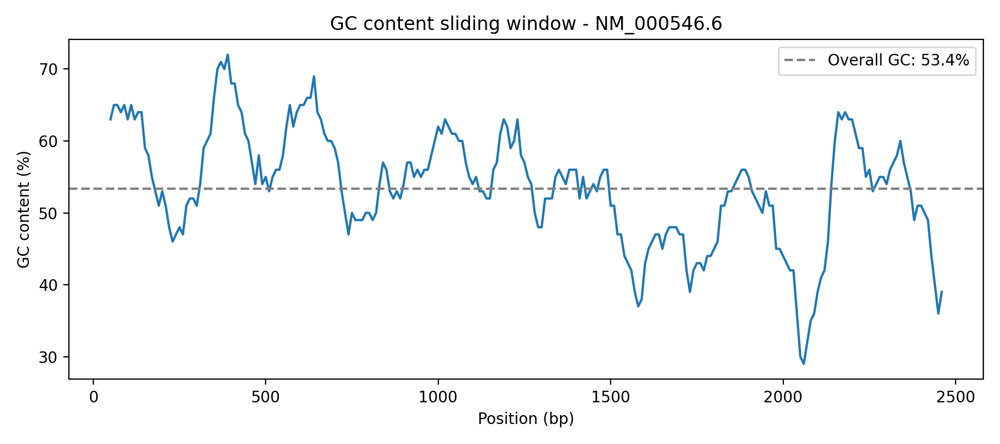
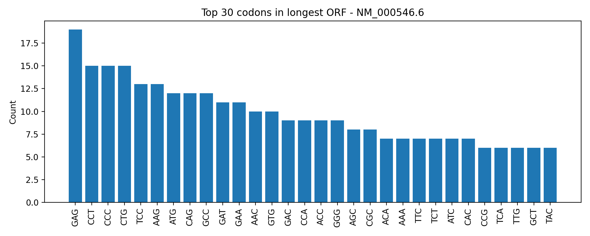

# Sequence Analysis Toolkit

A small Python tool for exploring DNA sequences: base composition, GC content,
reverse complement, transcription/translation, six-frame ORF finding, and codon usage.

## Biological question
Where are the likely protein-coding regions in a gene sequence, and how are its
base and codon composition distributed?

## What it does
- Fetches a sequence from NCBI by accession, or reads a local FASTA/GenBank file
- Reports length, base counts and GC content
- Computes reverse complement, RNA transcript and a frame 1 translation
- Finds ORFs (ATG to stop) on all six reading frames and exports them to `orfs.csv`
- Plots GC content along the sequence (`gc_content.png`)
- Plots codon usage of the longest ORF (`codon_usage.png`)

## Setup
```bash
python -m pip install -r requirements.txt
```
Open `sequence_toolkit.py` and replace `your_email@example.com` with your own email
(NCBI asks for this when using their API).

## Usage
```bash
python sequence_toolkit.py NM_000546                 # human TP53 mRNA
python sequence_toolkit.py my_gene.fasta             # local file
python sequence_toolkit.py NM_000546 --min-aa 50 --window 100
```

## Example: human TP53 (NM_000546.6)

| Property | Value |
|---|---|
| Length | 2,512 bp |
| GC content | 53.38% |
| ORFs found (min 30 aa) | 12 |
| Longest ORF | 393 aa (nt 143-1321, + strand, frame 2) |

Top ORFs:

| Strand | Frame | Position | Length (aa) |
|---|---|---|---|
| + | 2 | 143-1321 | 393 |
| + | 1 | 2023-2496 | 158 |
| - | 1 | 1231-1578 | 116 |
| - | 1 | 979-1194 | 72 |
| + | 3 | 678-878 | 67 |

### GC content along the transcript


GC content is high (65-72%) in the first part of the transcript and falls sharply
after about position 1500, reaching a minimum near 29% around position 2060.

### Codon counts in the longest ORF


GAG (Glu) is the most frequent codon, followed by proline codons (CCT, CCC) and CTG (Leu).

## Key findings
- The longest ORF (393 aa) matches the known length of the human p53 protein, and its
  sequence begins with the canonical p53 N-terminus (MEEPQSDPSVEPPLSQETFSDLWKLLPEN...).
- The other 11 ORFs of 30+ aa are much shorter and mostly lie outside the coding region
  or on the opposite strand, which shows why a length filter matters when predicting
  genes from sequence alone.
- The GC plot shows a GC-rich coding region and a distinctly AT-richer 3' UTR, with a
  minimum near 29% around position 2060.
- Codon counts in the longest ORF are dominated by GAG (Glu) and proline codons
  (CCT, CCC), consistent with p53's amino acid composition.

## Limitations
- The ORF finder only looks for ATG-to-stop frames, so it can miss genes with introns
  (on genomic DNA) or alternative start codons.
- The codon plot shows raw counts, not usage normalized per amino acid, so it should
  not be used on its own to judge codon bias.

## Tools
Python, Biopython, Matplotlib

## Data source
NCBI GenBank (public data).

## Next steps
- Normalize codon usage per amino acid (relative synonymous codon usage)
- Compare codon usage between two species
- Shade the ORF region on the GC plot
- Validate ORFs against annotated CDS features in the GenBank record
- Add a Streamlit interface