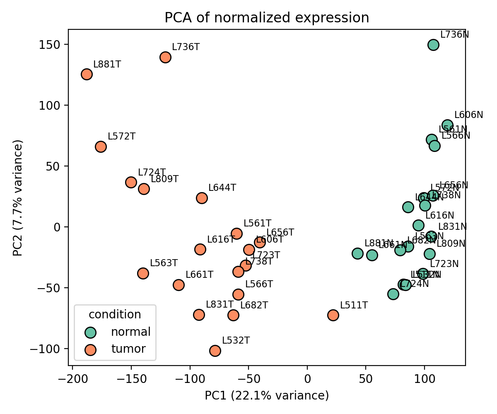
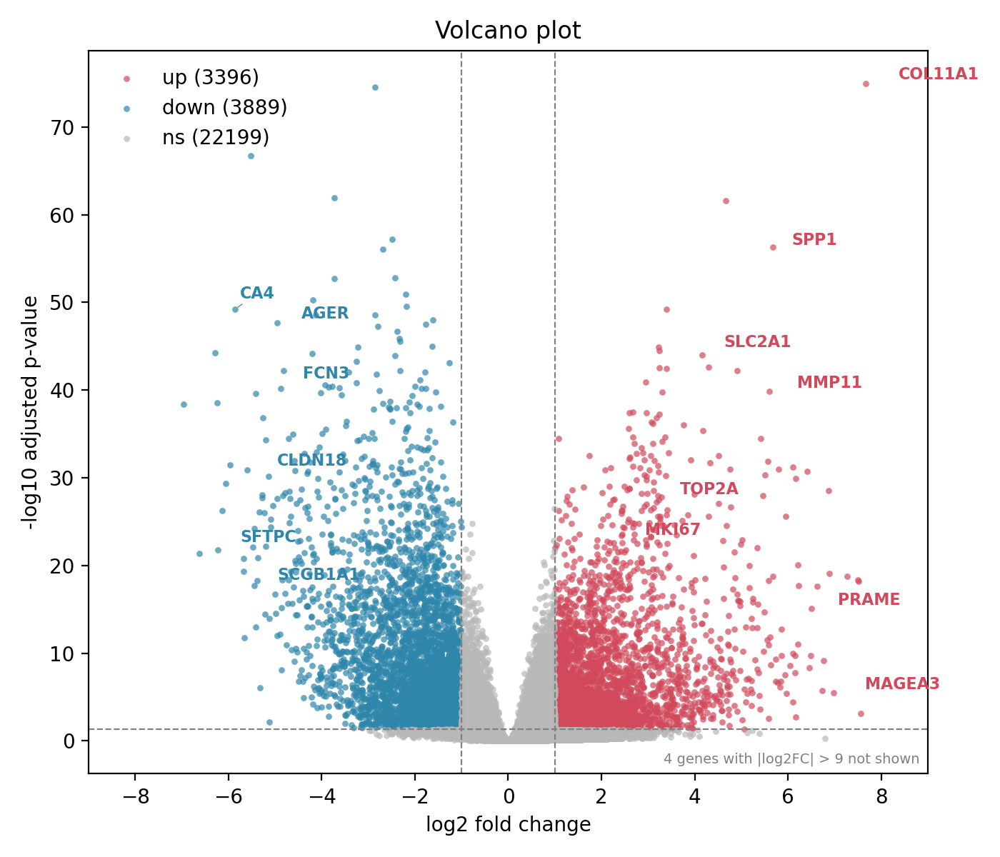
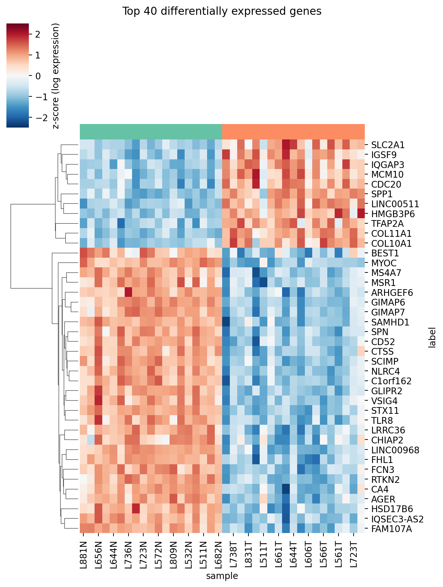

# RNA-seq Differential Expression Pipeline

A Python pipeline that takes a raw RNA-seq count matrix and finds genes that change
between two conditions, using PyDESeq2 (a Python implementation of the DESeq2 method).

## Biological question
> Which genes change expression between non-small cell lung cancer (NSCLC) tumors and
> matched normal lung tissue from the same patients, and what biological processes do
> they point to?

## What it does
1. Filters genes with very low counts
2. QC: library sizes per sample
3. Normalization and PCA to check that samples group by condition
4. Differential expression with PyDESeq2 (negative binomial model, Wald test, BH-adjusted p-values)
5. Volcano plot, MA plot, and a clustered heatmap of the top DE genes
6. Saves the full results table to `de_results.csv`

## Setup
```bash
python -m pip install -r requirements.txt
```

## Usage
Test the pipeline on simulated data (not real biology):
```bash
python rnaseq_de.py --demo
```

Run on the lung cancer data (paired design, with gene names):
```bash
python rnaseq_de.py --counts data/GSE81089_readcounts_featurecounts.tsv.gz --meta meta.csv \
    --treated tumor --control normal --pair-col patient --annotate \
    --highlight SFTPC,AGER,SCGB1A1,CLDN18,FCN3,CA4,COL11A1,SPP1,MMP11,TOP2A,MKI67,SLC2A1,PRAME,MAGEA3
```

Run on your own data:
```bash
python rnaseq_de.py --counts counts.csv --meta meta.csv \
    --condition-col condition --treated treated --control control
```
Useful options: `--pair-col` (paired design), `--annotate` (Ensembl ID to gene symbol,
needs internet), `--highlight` (genes to label on the volcano plot), `--padj`, `--lfc`, `--min-count`.

**Input files**
- `counts.csv`: first column = gene IDs/names, then one column per sample with raw integer counts
- `meta.csv`: first column = sample names (matching the counts columns), plus a column
  with each sample's condition

## Data
- **Source:** GEO [GSE81089](https://www.ncbi.nlm.nih.gov/geo/query/acc.cgi?acc=GSE81089) -
  RNA-seq of NSCLC tumors and matched normal lung tissue (Illumina HiSeq 2500, Homo sapiens)
- **File used:** `GSE81089_readcounts_featurecounts.tsv.gz` (raw featureCounts read counts, 63,152 genes x 218 samples)
- **Design:** 19 patients with a tumor sample and a matched normal sample (38 samples; the
  remaining 180 tumor-only samples were not used). Paired model: `~ patient + condition`
- **Reference:** Djureinovic D, Hallstrom BM, et al. Profiling cancer testis antigens in non-small-cell lung cancer. *JCI Insight* 2016;1(10):e86837. [doi:10.1172/jci.insight.86837](https://doi.org/10.1172/jci.insight.86837)

The counts file is not included in this repository. Download it from the GEO page and put it in a `data/` folder.

## Results




| | Count |
|---|---|
| Genes tested (after filtering) | 36,575 |
| Significant (padj < 0.05) | 14,224 |
| Upregulated in tumor (padj < 0.05, log2FC >= 1) | 3,396 |
| Downregulated in tumor (padj < 0.05, log2FC <= -1) | 3,889 |

### Key findings
- Tumors and their matched normals separate along PC1 (22% of variance), and the 19 normal samples cluster tightly.
- **Genes lost in tumors are normal lung genes:** *SFTPC* (log2FC -6.2), *SFTPB*, *AGER* (-5.0), *SCGB1A1* (-5.7),
  *CLDN18* (-5.6), *FCN3* (-4.8) and *CA4* (-5.9) are markers of normal alveolar and airway cells.
- **Genes gained in tumors point to growth and invasion:** cell-division genes (*TOP2A*, *MKI67*, *CDC20*, *MCM10*),
  tissue-remodeling genes (*COL11A1*, *COL10A1*, *MMP11*, *SPP1*), the glucose transporter *SLC2A1*, and
  tumor-associated antigens (*PRAME*, *MAGEA3*).
- Several immune-related genes (*MS4A7*, *MSR1*, *CD52*, *CTSS*, *SPN*) are lower in tumor tissue. Bulk tissue mixes
  many cell types, so this may reflect a different cell composition and not only changes inside tumor cells.
- These patterns agree with the known biology of lung cancer, which is a useful sanity check for the pipeline.
- With 19 pairs the test is very powerful, so over 14,000 genes pass padj < 0.05. Adding the fold-change cutoff
  (|log2FC| >= 1) leaves 7,285 genes, a more useful list for follow-up.
- Relation to the original study: the authors of the dataset (Djureinovic et al., 2016) used it to profile cancer-testis antigens, not to run a tumor-versus-normal comparison, so this is an independent analysis of their data and not a replication. Two of the tumor-associated antigens highlighted here (*PRAME*, *MAGEA3*) belong to that same family of genes.

## Methods notes
- Genes with fewer than 10 total counts across samples were removed
- Size-factor normalization (median of ratios), gene-wise dispersion estimation and
  shrinkage, Wald test, Benjamini-Hochberg correction (all within PyDESeq2)
- Significance: adjusted p-value < 0.05; volcano plot also uses |log2FC| >= 1

## Limitations
- About 7,100 of the 36,575 tested genes could not be mapped to a gene symbol (mostly non-coding or
  unannotated genes) and keep their Ensembl ID
- Only 19 patients, so results may not generalize to all NSCLC
- Tumor subtypes (for example adenocarcinoma and squamous cell carcinoma) were analyzed together, not separately
- Bulk tissue RNA-seq mixes cell types, so some changes reflect tissue composition
- Differential expression shows association, not causation
- Results depend on the cutoffs chosen

## Tools
Python, PyDESeq2, pandas, NumPy, scikit-learn, Matplotlib, seaborn, adjustText, MyGene.info

## Next steps
- GO / KEGG pathway enrichment on the DE genes
- Compare adenocarcinoma and squamous cell carcinoma separately
- Streamlit app to explore results interactively
